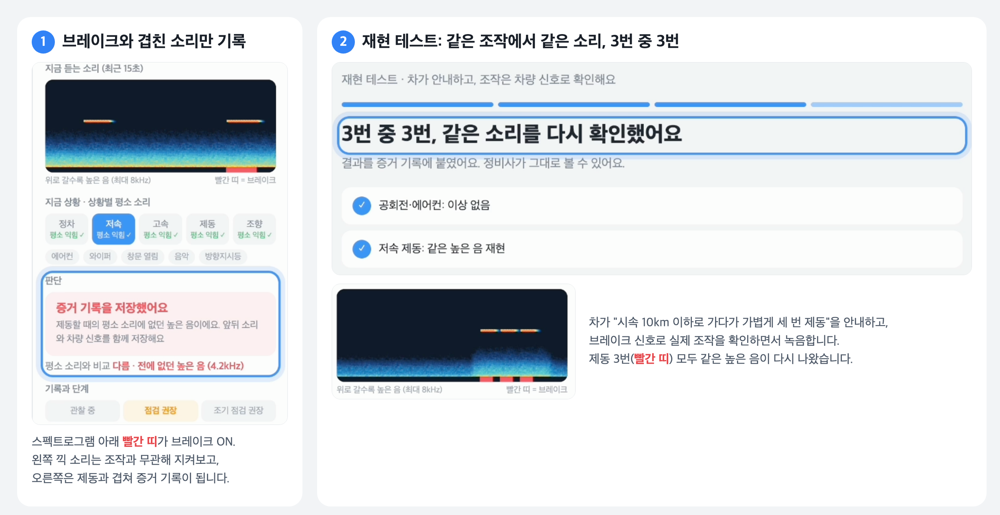
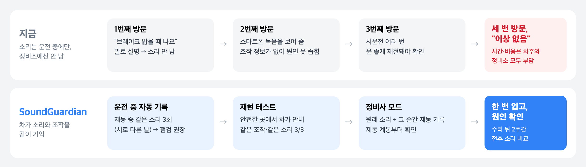

# SoundGuardian (사운드 가디언)

**정비소에선 안 나는 그 소리, 차가 대신 기억하고 재현합니다.**

현대자동차그룹 차량용 앱 개발 공모전(Pleos App Market) 출품작의 웹 프로토타입입니다.
달리다가 평소와 다른 소리가 나면, 그때 브레이크를 밟고 있었는지·핸들을 돌리고 있었는지까지 같이 남기고,
필요하면 차가 운전자에게 그 조건을 다시 만들어 보라고 안내하는 앱을 웹으로 먼저 만들어 본 것입니다.

## 실행 방법
- `index.html`을 크롬에서 열면 바로 됩니다. 설치할 것은 없습니다.
- 소리가 나오니 스피커를 켜 주세요. (브라우저 정책 때문에 첫 클릭 후 소리가 시작됩니다)

## 해 볼 수 있는 것
| 버튼 | 내용 |
|---|---|
| 시연 영상 모드 | 약 2분 동안 전체 흐름이 자동으로 진행됩니다 |
| 직접 조작해 보기 | 왼쪽 조작판으로 속도·조향·브레이크·에어컨·와이퍼 등을 직접 바꿔 봅니다 |
| `B` 키 | 브레이크 켜기/끄기 |
| `S` 키 (누르는 동안) | 끽 소리 내기 |

브레이크 없이 끽 소리를 내면 기록하지 않고, 브레이크를 켠 채로 내면 '증거 기록'이 남습니다.
와이퍼를 켜면 와이퍼 소리는 걸러지고, 운행 종료를 누르면 리포트 → 재현 테스트 → 정비사 모드 → 수리 전후 비교 → 정비소 길 안내까지 이어집니다.

## 화면 구성
- **왼쪽 데모 조작판**: Pleos Connect 에뮬레이터의 차량 신호(Virtual Console) 역할입니다. 실제 앱 화면이 아닙니다.
- **가운데 차량 화면**: 실제 앱이 차량 디스플레이에 보여 줄 화면입니다. 운전 중에는 아무것도 띄우지 않습니다.
- **오른쪽 판단 과정**: 앱이 소리를 어떻게 판단하는지 보여 주는 설명용 패널입니다.

## 솔직하게 밝혀 두는 부분
- 이 프로토타입의 소리(노면 소음, 끽 소리, 와이퍼 소리)는 Web Audio로 합성한 것이고, 판정은 브라우저에서 실제 주파수 분석으로 합니다.
- 실제 차 소리로는 아직 검증하지 못했습니다.
- 실제 앱은 Android(Kotlin) + Pleos Connect SDK(Vehicle, FusedLocation, NaviHelper, TTS, STT, Gleo App Schema)로 만들 예정입니다.

